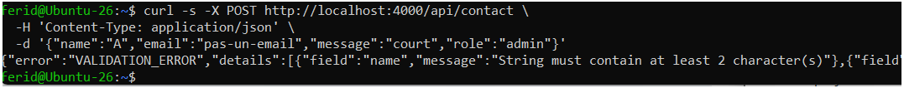
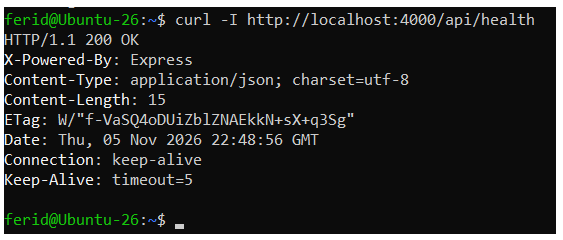
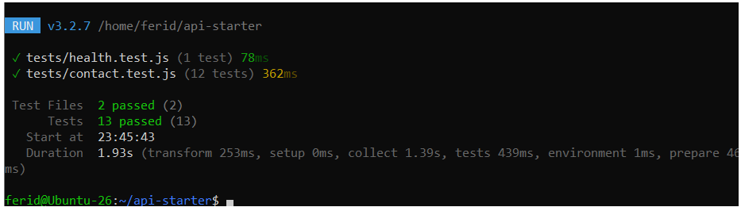
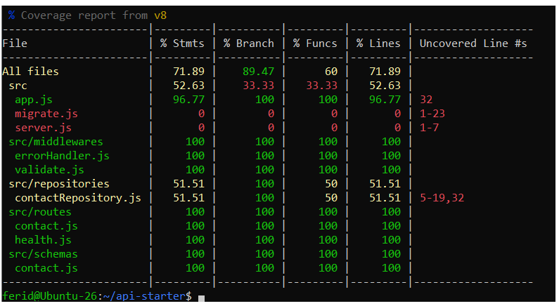
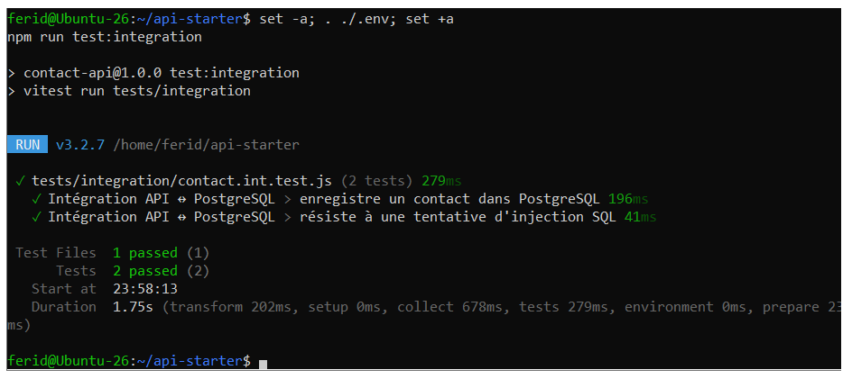

# contact-api

API Express de formulaire de contact, sécurisée et testée (TP8, Master DevOps & Cloud, ISET Tozeur).

## Objectif

Rendre une API volontairement fragile robuste : validation des entrées (Zod),
durcissement HTTP (Helmet, limite de taille, rate limiting), tests automatisés
(Vitest, Supertest) et test d'intégration contre PostgreSQL.

## Prérequis

- Node.js 24, npm
- Docker et Docker Compose

## Installation

    npm install
    npm test

## Avancement

- [x] Mise en place du projet
- [x] Partie 1 : tableau OWASP (voir OWASP.md)
- [x] Partie 2 : validation et gestion des erreurs
- [x] Partie 3 : durcissement HTTP
- [x] Partie 4 : tests de routes
- [x] Partie 5 : intégration PostgreSQL et migrations

## Captures

Les captures sont dans le dossier `captures/`.
## Captures

---

# TP9 : Pipeline as Code avec Jenkins

Pipeline Jenkins décrit dans le dépôt (`Jenkinsfile`) pour `contact-api` : stages,
exécution parallèle, agent Docker, credentials, rapport JUnit, image Docker taguée
avec le Git SHA, puis job Multibranch (une branche et une Pull Request).

## Prérequis

- Jenkins LTS sur la VM Ubuntu avec Docker (utilisateur `jenkins` dans le groupe `docker`)
- Plugins : Pipeline, Git, GitHub Branch Source, Docker Pipeline, JUnit,
  Credentials Binding, Workspace Cleanup, Timestamper
- Compte Docker Hub avec un access token

## Avancement

- [x] Partie 1 : premier pipeline depuis le dépôt (Pipeline script from SCM)
- [x] Partie 2 : agent Docker, stages parallèles, rapport JUnit
- [x] Partie 3 : image taguée avec le Git SHA, credentials, push depuis `main`
- [ ] Partie 4 : Multibranch Pipeline (branche et Pull Request)
- [ ] Défi : Shared Library et GitHub Checks (optionnel)

## Captures du TP9

Les captures sont dans `captures/tp9/` :
`pipeline-stages.png`, `junit-report.png`, `credentials-masked.png`,
`dockerhub-sha-tag.png`, `multibranch.png`, `shared-library.png` (défi).
